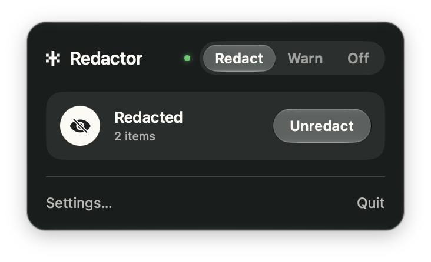

# Redactor

Redact personal data when you copy or paste on your Mac, so it doesn't end up
in chats, agents, or email. The [Redact](https://desertant.com/models/redact/)
model runs on your Mac, and nothing you copy leaves it.


## Install

```bash
brew tap desert-ant-labs/tap
brew install --cask redactor
```

Homebrew 6 asks you to approve a tap when you add it first. Answering that
prompt covers Redactor, and `brew trust desert-ant-labs/tap` covers
anything Desert Ant publishes later.

Or download the [disk image](https://github.com/Desert-Ant-Labs/demo-redactor/releases/latest)
and drag Redactor to Applications. Redactor works on macOS 26 or later on Apple
Silicon. Redact (12MB) downloads on first launch.

## How it works

- **Copy** text with names, emails, phone numbers, addresses, or card and bank
  numbers, and Redactor turns them into placeholders like `[EMAIL_1]`. Click
  Unredact, or copy the same text again within 5s, to get the original back.
- **Paste** unredacted personal data into a chat, AI, or email app, and
  Redactor stops the paste until you choose Paste Redacted, Paste Anyway, or
  Cancel.
- **Copy a screenshot**, and Redactor blurs the personal data in it.
- **Copy a file** in Finder, and Redactor reads it: text, CSV, Word, PDF, and
  images. A file stays a file until you click Redact.



## Settings

### Copy

- **Mode**: Redact, Warn, or Off, also in the menu. Warn tells you what it
  found and leaves the copy as it is.
- **Check images**: blur personal data in screenshots and images you copy.
- **Check files**: read files you copy in Finder for personal data.
- **Personal data**: the kinds Redactor redacts and warns about, like names,
  addresses, and card numbers. All 9 are on by default.
- **Whitelist**: what Redactor leaves alone. Copies from apps like password
  managers and terminals are never read, and your own email, phone number,
  and name are never flagged. The default apps are in
  [`App/Resources/app-whitelist.json`](App/Resources/app-whitelist.json).

### Paste

- **Warn before pasting**: stop a paste with personal data into an app on the
  watchlist.
- **Watchlist**: the apps where Redactor checks what you paste. The defaults
  are in [`App/Resources/app-watchlist.json`](App/Resources/app-watchlist.json).

### General

- **Open at login**: start Redactor when you log in to your Mac.
- **Check for updates automatically**: look for a new release once a day with
  [Sparkle](https://sparkle-project.org), and ask before installing it. Check
  for Updates in the menu checks right away. An update installs only when it
  is signed with the Desert Ant Labs key.

## Permissions

- **Accessibility**, to stop a paste.
- **Clipboard access**: set Redactor to always allow in System Settings >
  Privacy & Security, or macOS asks on every copy.

## Limits

- Only Command V is checked. Paste from the Edit menu, or dragging a file into
  an app, goes through.
- Pastes into terminals and code editors are not checked by default.
- Card numbers, IBANs, and national ID numbers only count when their check
  digits are right, so a made-up number like 1234 5678 9012 3456 goes through.
  To try Redactor, use a test card number from your payment provider.
- Redact misses some names. Check anything sensitive before you share it.

## Build from source

The tasks run through [mise](https://mise.jdx.dev) (`brew install mise`).

```bash
git clone https://github.com/Desert-Ant-Labs/demo-redactor.git
cd demo-redactor
mise trust && mise install
mise run run
```

Set `REDACTOR_TEAM_ID` to your Apple developer team, or macOS asks for
Accessibility again after every build. The other tasks are `build`, `test`,
`xcode`, `package`, and `clean`.

## License

The Redactor source is MIT ([`LICENSE`](LICENSE)), and
[`THIRD_PARTY_NOTICES.md`](THIRD_PARTY_NOTICES.md) covers the rest. Redact is
under the [Desert Ant Labs Source-Available License](https://license.desertant.com/1.0).
